# 📹 ĐIỆN NƯỚC CAMERA

**Website trưng bày camera an ninh, thiết bị điện – nước – chiếu sáng, kèm trang quản trị tự cập nhật**

Sản phẩm có bộ lọc · Nhật ký thi công · Hậu trường thi công · Khách chỉ xem rồi liên hệ qua hotline/Zalo

---

## Mục lục

1. [Giới thiệu](#1-giới-thiệu)
2. [Tính năng nổi bật](#2-tính-năng-nổi-bật)
3. [Vai trò người dùng](#3-vai-trò-người-dùng)
4. [Kiến trúc hệ thống](#4-kiến-trúc-hệ-thống)
5. [Các luồng hoạt động](#5-các-luồng-hoạt-động)
6. [Dữ liệu lưu ở đâu](#6-dữ-liệu-lưu-ở-đâu)

---

## 1. Giới thiệu

**Điện Nước Camera** là website của một cửa hàng/đội thi công lắp đặt camera an ninh, thiết bị điện dân dụng, thiết bị nước và đèn chiếu sáng. Website **chỉ trưng bày để khách xem**: không có giỏ hàng, đặt hàng hay thanh toán. Khách xem sản phẩm, đọc nhật ký các công trình đã làm rồi liên hệ qua **hotline / Zalo** ở đầu và chân trang.

Chủ cửa hàng tự cập nhật mọi nội dung ở trang quản trị `/admin`, trên cả điện thoại, không cần sửa code.

## 2. Tính năng nổi bật

**Khách xem web**
- Trang chủ có banner, thanh chữ chạy khuyến mãi, danh mục sản phẩm, dịch vụ, nhật ký thi công và mục **Hậu trường thi công** (ảnh/video).
- Danh sách sản phẩm có bộ lọc theo danh mục, thương hiệu, từ khoá; **so sánh sản phẩm** trong cửa sổ riêng.
- Trang chi tiết sản phẩm 8 phần: ảnh, 4 ô nổi bật, giới thiệu, đặc điểm, thông số, hướng dẫn, bảo hành.
- Tối ưu cho điện thoại: thanh điều hướng dưới, lưới danh mục, nút liên hệ nổi.

**Chủ cửa hàng (trang quản trị)**
- **Sản phẩm**: thêm/sửa/xoá, chọn danh mục là tự hiện khung thông số tương ứng.
- **Nhật ký thi công**: đăng công trình kèm ảnh tải trực tiếp.
- **Hậu trường thi công (Giải trí)**: đăng nhiều ảnh/video một lượt, ghim, chú thích.
- **Banner & thanh chạy**: sửa chữ, thay ảnh banner.
- **Khách hàng & thiết bị**: lưu hồ sơ khách, thiết bị đã lắp, ảnh (kho riêng tư).
- **Ghi chú, chấm công, danh mục**, **sao lưu / khôi phục / hoàn tác toàn bộ dữ liệu**, theo dõi dung lượng.
- **Cài đặt & bảo mật**: đổi tài khoản, mật khẩu, đăng xuất mọi nơi.

## 3. Vai trò người dùng

| Vai trò | Khu vực | Quyền chính |
| --- | --- | --- |
| Khách | `/` | Xem sản phẩm, công trình, ảnh/video; liên hệ qua hotline/Zalo |
| Chủ cửa hàng | `/admin` | Toàn bộ quản trị. Đăng nhập bằng email hoặc số điện thoại + mật khẩu |

Đăng nhập sai 8 lần từ cùng một nơi thì khoá 15 phút; phiên sống 7 ngày; mật khẩu băm scrypt.

## 4. Kiến trúc hệ thống

> Các sơ đồ bên dưới là ảnh SVG động: chấm sáng chạy dọc mũi tên theo từng bước, node được tô sáng khi dữ liệu tới.

Chạy **một dịch vụ duy nhất** trên Render: Express vừa trả API vừa phục vụ bản build của React, nên không cần cấu hình CORS.

## 5. Các luồng hoạt động

### 5.1. Khách xem sản phẩm và liên hệ

### 5.2. Chủ cửa hàng đăng ảnh/video không làm nặng máy chủ

### 5.3. Đăng nhập quản trị

### 5.4. Lưu dữ liệu khi deploy lại

## 6. Dữ liệu lưu ở đâu

| Thứ | Nơi lưu | Biến môi trường |
| --- | --- | --- |
| Sản phẩm, công trình, cài đặt, chú thích | Neon Postgres (bảng `du_lieu`) | `DATABASE_URL` |
| Ảnh sản phẩm, banner, ảnh/video hậu trường | Neon Object Storage (công khai) | `NEON_S3_*` |
| Ảnh khách hàng | Neon Object Storage riêng tư | `NEON_S3_RT_*` |
| Chế độ thay thế cho ảnh/video | Cloudinary | `CLOUDINARY_URL` |

Chưa đặt biến nào thì web vẫn chạy, nhưng dữ liệu chỉ nằm trên máy chủ và mất khi deploy lại.
