# 📹 ĐIỆN NƯỚC CAMERA

**Website trưng bày camera an ninh, thiết bị điện – nước – chiếu sáng, kèm trang quản trị tự cập nhật**

Sản phẩm có bộ lọc & so sánh · Nhật ký thi công · Hậu trường thi công · Khách xem rồi liên hệ hotline/Zalo

---

## Mục lục

1. [Giới thiệu](#1-giới-thiệu)
2. [Tính năng nổi bật](#2-tính-năng-nổi-bật)
3. [Vai trò người dùng](#3-vai-trò-người-dùng)
4. [Kiến trúc hệ thống](#4-kiến-trúc-hệ-thống)
5. [Các luồng hoạt động](#5-các-luồng-hoạt-động)

---

## 1. Giới thiệu

**Điện Nước Camera** là website của một cửa hàng/đội thi công lắp đặt camera an ninh, thiết bị điện dân dụng, thiết bị nước và đèn chiếu sáng. Website **chỉ trưng bày để khách xem**: không có giỏ hàng, đặt hàng hay thanh toán. Khách xem sản phẩm, đọc nhật ký các công trình đã làm rồi liên hệ qua **hotline / Zalo** ở đầu và chân trang.

Chủ cửa hàng tự cập nhật mọi nội dung ở trang quản trị, kể cả trên điện thoại, không cần sửa code.

## 2. Tính năng nổi bật

**Khách xem web**
- Trang chủ có banner, thanh chữ chạy khuyến mãi, danh mục sản phẩm, dịch vụ, nhật ký thi công và mục **Hậu trường thi công** (ảnh/video).
- Danh sách sản phẩm có bộ lọc theo danh mục, thương hiệu, từ khoá; **so sánh sản phẩm** trong cửa sổ riêng.
- Trang chi tiết sản phẩm 8 phần: ảnh, 4 ô nổi bật, giới thiệu, đặc điểm, thông số, hướng dẫn, bảo hành.
- Tối ưu cho điện thoại: thanh điều hướng dưới, lưới danh mục, nút liên hệ nổi.

**Chủ cửa hàng (trang quản trị)**
- **Sản phẩm**: thêm/sửa/xoá; chọn danh mục là tự hiện khung thông số tương ứng.
- **Nhật ký thi công**: đăng công trình kèm ảnh tải trực tiếp.
- **Hậu trường thi công**: đăng nhiều ảnh/video một lượt, ghim, chú thích.
- **Banner & thanh chạy**: sửa chữ, thay ảnh banner.
- **Khách hàng & thiết bị**, ghi chú, chấm công, danh mục.

## 3. Vai trò người dùng

| Vai trò | Quyền chính |
| --- | --- |
| Khách | Xem sản phẩm, công trình, ảnh/video; liên hệ qua hotline/Zalo |
| Chủ cửa hàng | Toàn bộ quản trị nội dung |

## 4. Kiến trúc hệ thống

> Các sơ đồ bên dưới là ảnh SVG động: chấm sáng chạy dọc mũi tên theo từng bước, node được tô sáng khi dữ liệu tới.

Một dịch vụ duy nhất vừa trả dữ liệu vừa phục vụ giao diện, nên không cần cấu hình thêm.

## 5. Các luồng hoạt động

### 5.1. Quản lý sản phẩm và trải nghiệm xem hàng

Chọn danh mục là khung thông số tương ứng tự hiện ra, nên nhập sản phẩm nhanh và đồng nhất. Phía khách có lọc, so sánh và trang chi tiết đủ 8 phần.

### 5.2. Nhật ký thi công

Công trình mới nhất luôn tự lên đầu theo ngày khởi công, không cần sắp xếp thủ công.

### 5.3. Đăng ảnh/video không làm nặng máy chủ

Ảnh được nén ngay trên máy rồi tải thẳng lên kho lưu trữ, máy chủ chỉ cấp quyền tải lên, nên video lớn cũng không làm nghẽn dịch vụ.

